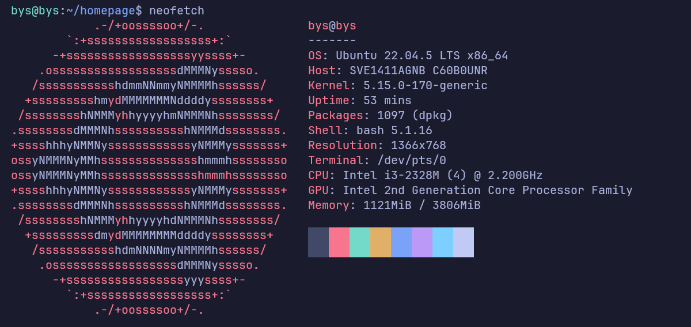
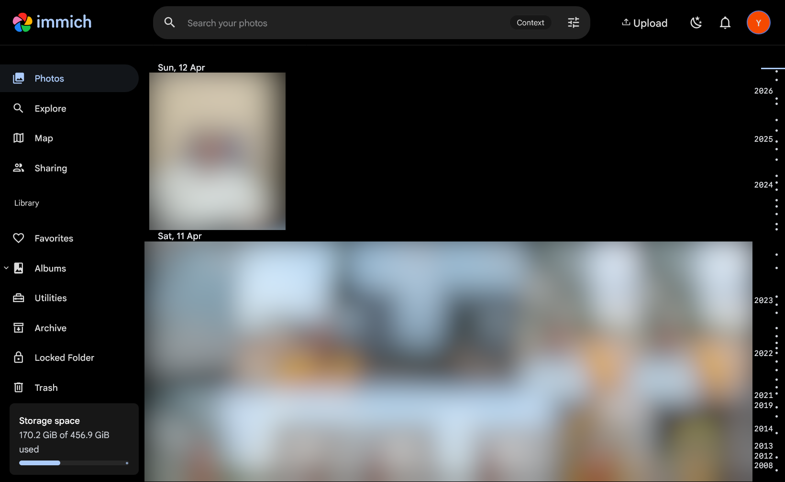
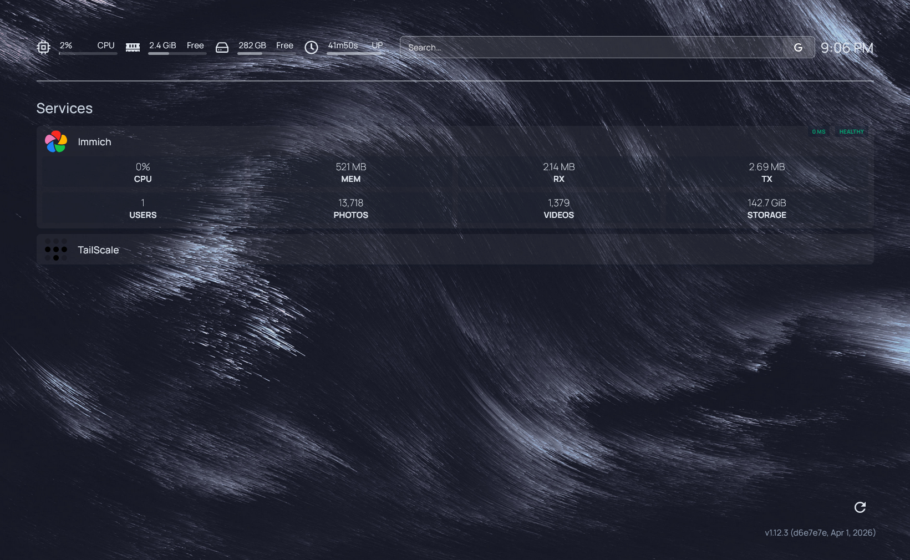

This is an self-hosted homelab running on my old laptop which got repurposed as an home server. Built to replace google photos especially because of its 15gb limit and for privacy.

im making this blog post for archiving what i did so dont expect any guide from me for this kek, the home labbing rabbit hole is really fun so search away ur questions!

## Why did i do this

I always saw youtube videos about self hosting and got interested in it. I have tons of personal photos (~150gb of photos) in my external hard drive and i wanted get access to them anywhere in my mobile/laptop like google photos so i turned laptop into an server :p

## info about my laptop

i got this laptop from my dad's office like 10 years ago (very old), it is an sony vaio (You probably never heard of this because it's very old and discontinued now xD) and It has 512gb HDD storage with 4gb ram :3



## Services i used

| Service       | Purpose                                                                  |
| ------------- | ------------------------------------------------------------------------ |
| **Immich**    | Self-hosted photo & video backup (Google Photos open source alternative) |
| **Homepage**  | Displays all services in my server very aestheticly                      |
| **Tailscale** | Secure remote access via VPN mesh network (Can use immich anywhere)      |

---

## Architecture

```
                        ┌─────────────────────────────────┐
                        │         Old Laptop Server       │
                        │         (Ubuntu Server)         │
                        │                                 |
                        |                                 │
 Local Network     ─────|  :2283  Immich                  |
                        │  :3000  Homepage Dashboard      │
                        │                                 │
                        │  ┌─────────────────────────┐    │
                        │  │      Docker images      │    │
                        │  │  immich-server          │    │
                        │  │  homepage               │    │
                        │  └─────────────────────────┘    │
                        │                                 │
                        └───────────────-─────────────────┘
                                        │
                        ┌───────────────▼─────────────────┐
                        │       Tailscale Network         │
                        │   Access from phone / laptop    │
                        │     anywhere in the world       │
                        └─────────────────────────────────┘
```

---

## More about the services that i used

### Immich

It is an google photos alternative which can be self hosted
in our devices with all the features of google photos and
even gives us some machine learning stuff to organize photos
better. It even has backup techniques and is open source with constant updates from the community which is nice

**Access:** i use `http://<server-ip>:2283` on local network, or via Tailscale IP if im elsewhere

below is an screenshot of the homepage so u get an idea



### Homepage Dashboard

This is like a hub of sorts like home assistant but with
all the services we use. It has most of the things so its useful. We can know easily if something is down and it looks cool

**Access:** i use `http://<server-ip>:3000` or tailscale ip.



### Tailscale

Tailscale acts like a vpn which lets me connect to my home internet from anywhere, i cannt set an static ip or port forward with my airtel router so this was a life saver :p I LOVE YOU TAILSCALE

---

## References

- [Immich Documentation](https://docs.immich.app)
- [Tailscale Documentation](https://tailscale.com/kb)
- [Docker Documentation](https://docs.docker.com)
